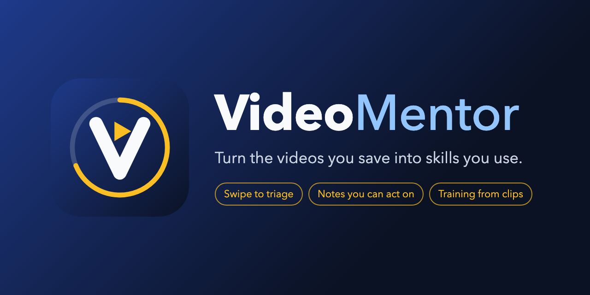

<p align="center"></p>

# VideoMentor

**Turn the videos you save into skills you use.** VideoMentor is a private app you run on your own computer. It collects the YouTube videos you've saved, lets you triage them one card at a time on your phone, writes notes you can act on for the keepers, and builds short training lessons out of exact clips from many videos.

Free and open source under the [GNU AGPL-3.0](LICENSE).

## What it does
| Stage | What happens |
|---|---|
| **Collect** | Syncs Watch Later, the playlists you choose and YouTube links in your browser bookmarks. Read-only: it never changes anything on YouTube. |
| **Triage** | One card at a time: keep, archive, analyze first, or group related videos. Undo up to 20 steps. Pull extra videos from any channel (newest, oldest or a date range, with Shorts and live streams as switches). |
| **Understand** | Kept videos get notes from their transcripts: the core idea, frameworks, one to three "try this week" actions, and a key moment with a timestamp checked against the real captions. |
| **Apply** | An actions checklist, and training modules made of clips with exercises and a quiz. Play a module as one lesson in the app, or render it as a narrated video for your own use. |
| **Review** | A Tags page for every tag, with its videos sortable by usefulness, length, words, notes and open actions. Insights shows your skills, keep rates, where your inbox piles up and how many tokens processing used. Home suggests one "Next up": the best video to watch, or one step to try. |

It runs as a web app on your computer and installs on your phone's home screen. It works on iPhone, iPad and Mac, in portrait or landscape.

## What you need
- macOS (Linux and Windows support is not there yet: the background service, Safari bookmarks and the narration voice are macOS-only).
- Python 3.12 and [uv](https://docs.astral.sh/uv/), Node 20 or later.
- A Google account with YouTube, signed in to YouTube in Chrome.
- The [Claude Code](https://docs.anthropic.com/en/docs/claude-code) command-line tool, signed in. VideoMentor uses it for tags, scores, notes and training, on your own Claude plan.
- Optional: ffmpeg and Google Chrome, for rendered training videos.
- [Tailscale](https://tailscale.com/) on your Mac and phone, to use the app on your phone (without it, it works in the Mac's browser only).

Setup takes about 30 minutes: see **[docs/setup.md](docs/setup.md)**.

## Quick start
```sh
uv sync
cd web && npm install && npm run build && cd ..
uv run vm sync      # first sync, from Terminal (reads your browser's YouTube login)
uv run vm serve     # then open http://127.0.0.1:8791 on the Mac; for your phone see docs/setup.md
```

## Mac app
An optional menu bar app that runs the engine for you and opens the library in a window. Build it on your Mac (needs Xcode command line tools and a code signing identity):
From your clone, run `uv run vm install` first, before building or opening the app (`vm` is not on your PATH until then). Then build:
```sh
mac/scripts/build-app.sh      # makes mac/build/VideoMentor.app, signed
```
The script signs with `VM_SIGN_IDENTITY` if you set it (a certificate name from `security find-identity -v -p codesigning`), otherwise with the first "Apple Development" certificate in your keychain, otherwise ad-hoc. Ad-hoc apps work, but macOS may forget permissions such as Start at Login after each rebuild. The first time you open the app, macOS may ask you to confirm it: right-click it and choose Open, or use System Settings > Privacy & Security > Open Anyway.
Its menu shows the library status, opens the app window, shows the pairing link and QR code for your phone, and has a Start at Login switch. The app starts `vm serve` when it opens, so quitting the app stops its engine. It needs the `vm` tool installed (`vm install`) and macOS 14 or later.
Use **Show in** in its menu to show VideoMentor in the Dock, the menu bar, or both (the default). In the Dock, click the icon to open the window, or right-click it for the same menu.

## Commands (`vm`)
| Command | Does |
|---|---|
| `vm sync` | Pull Watch Later, playlists that are on and bookmarked YouTube links, then fetch details. Run it from Terminal: the background service can't read browser data, so this also saves a login copy for it. |
| `vm prep` | Write card summaries, topics, tags and a signal score for new videos. |
| `vm analyze` | Write notes for queued videos. |
| `vm status` | Library counts and last sync. |
| `vm stats` | LLM calls, tokens and cost by step, for all time and the last 7 days. The cost is what the API would charge; it is not billed on Pro or Max plans. |
| `vm playlists` | List playlists; turn syncing on or off. |
| `vm youtube-login` | Sign in to the YouTube Data API (read-only) for playlist dates and channel pulls. |
| `vm train "<tag>"` | Build a training module from kept videos with that tag. |
| `vm render <module>` | Render a module as one narrated video (personal use only, see below). |
| `vm tags` | Review proposed tag merges; `--draft` suggests new ones. |
| `vm transcripts` | Keep transcripts for analyzed videos that don't have one. |
| `vm import-library <folder>` | Copy a library folder (for example from an older install) into `~/VideoMentor`. The original is left untouched as a backup. |
| `vm backup [--list]` | Back up the library now (and prune old backups), or list the backups with sizes. |
| `vm export` | Rewrite every video's Markdown notes. |
| `vm pair [--new]` | Show the pairing link and 12-digit code for a phone; `--new` makes a new code. |
| `vm devices [--sign-out ID \| --sign-out-all]` | List paired devices, or sign one or all out (also on Status > Paired devices). |
| `vm serve` | Run the app and its background worker. |
| `vm install` | Install the `vm` tool and the app copy without a login service (used by the Mac app). |
| `vm launch-info --json` | Print how to start the engine: program, environment, log, port, pairing code, version and build. |
| `vm install-service` / `uninstall-service` | Start `vm serve` at login (macOS). |
| `vm --version` | Version and build. |

Your library lives in `~/VideoMentor/` (set `VM_HOME` to move it). Nothing in it is ever sent anywhere except the YouTube and Claude requests the features need. Usage tracking (`vm stats`) keeps only token counts and costs, on your Mac, for 180 days.

## Backups and restore
VideoMentor backs up your library once a day while the app is running and keeps 14 days, in `~/VideoMentor/backups`. Each day has `library-<date>.db.gz` and, if you have training modules, `training-<date>.tar.gz`. Secrets (sign-in tokens and cookies) are not included. To restore:
1. Quit the VideoMentor app (or stop `vm serve`).
2. `gunzip -c ~/VideoMentor/backups/library-<date>.db.gz > ~/VideoMentor/library.db`
3. Delete any `library.db-wal` and `library.db-shm` files in `~/VideoMentor`.
4. Reopen the app.

## Please read: YouTube and your own use
- VideoMentor reads YouTube two ways: the official YouTube Data API (read-only) with your own Google Cloud client, and [yt-dlp](https://github.com/yt-dlp/yt-dlp) using your browser's YouTube login. yt-dlp access is common in open-source tools but sits outside YouTube's API terms. You run VideoMentor on your own account, at your own risk.
- **Rendered training videos download clips. They are for your personal use only. Don't share or publish them:** the clips belong to their creators. The in-app lesson player plays clips in YouTube's own player and downloads nothing.
- VideoMentor is not affiliated with or endorsed by YouTube or Google.

## Develop
```sh
uv sync
uv run pytest
uv run ruff check src tests
cd web && npm install && npm test && npx tsc --noEmit && npm run build
```
See [CONTRIBUTING.md](CONTRIBUTING.md).

## License and name
Code: [GNU Affero General Public License v3.0](LICENSE). You may use, study, change and share VideoMentor, including commercially. If you distribute a changed version, or run one as a service for others, you must publish your changes under the same license.

The VideoMentor name and logo are not covered by the code license: see [TRADEMARKS.md](TRADEMARKS.md).

Copyright 2026 Christopher Larkin.
